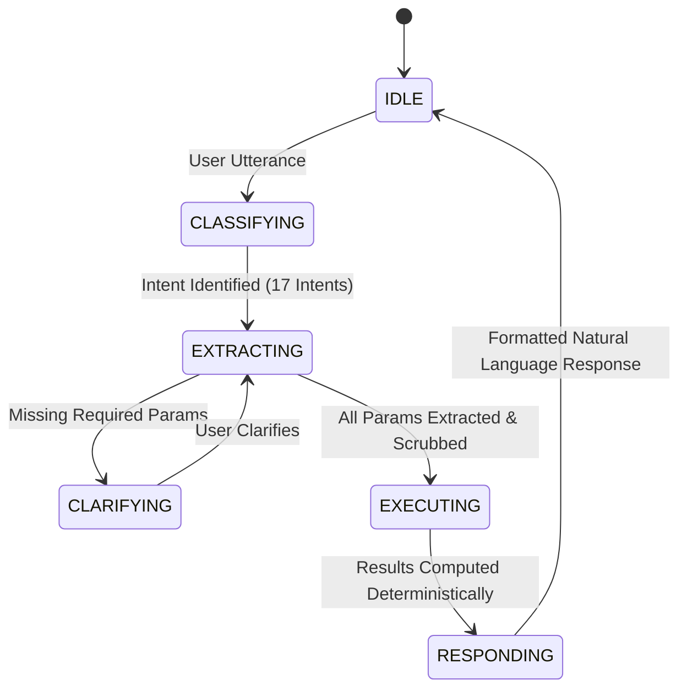

# 🍳 Recipe Agent — Grounded Conversational AI Engine

> **A production-grade conversational recipe chatbot built over the Recipe Box dataset (~125,000 recipes) using a Deterministic State Machine architecture.**  
> Grounded in real data, strictly avoiding hallucinations, and capable of multi-turn search, analytics, pantry matching, and evidence-based substitutions.

---

## 🚀 Quick Start (Running on the Interviewer's Machine)

### 1. Clone & Set Up Virtual Environment

```bash
git clone https://github.com/bhardwaj-yash1/recipe-chatbot.git
cd recipe-chatbot

# Create virtual environment
python -m venv venv

# Activate virtual environment
# Windows:
.\venv\Scripts\activate
# Linux/macOS:
source venv/bin/activate

# Install dependencies
pip install -r requirements.txt
```

### 2. Configure Environment Variables

Create a `.env` file from `.env.example`:
```bash
cp .env.example .env
```
Ensure your Groq API keys are set in `.env`:
```ini
GROQ_API_KEY_1=gsk_...
GROQ_API_KEY_2=gsk_...
GROQ_API_KEY_3=gsk_...
PRIMARY_MODEL=openai/gpt-oss-120b
FALLBACK_MODEL=openai/gpt-oss-20b
```

### 3. Launch the Streamlit Web Application

```bash
streamlit run app.py
```
*Note: On first startup, if the raw dataset files are missing, `core/data_loader.py` automatically downloads and unpacks `recipes_raw.zip` into `data/`, parses all 125,164 recipes, and caches FAISS/BM25/inverted indexes in `data/processed/` (~2 minutes on first run; ~17 seconds on subsequent restarts via `recipes.pkl`).*

---

## 🧪 Running the Automated Test Suites & Evaluation

### Run All Unit & Integration Tests (pytest)
```bash
# Run analytics engine tests (14 tests)
pytest tests/test_analytics.py -v

# Run matching and substitution engine tests (10 tests)
pytest tests/test_matching.py tests/test_substitution.py -v

# Run safety, edge cases, and hallucination guard tests (5 tests)
pytest tests/test_edge_cases.py -v

# Run all 30 conversational multi-turn scenarios
pytest tests/test_conversations.py -v
```

### Run the Reproducible Evaluation Suite
```bash
python tests/evaluation/eval_suite.py
```
This script runs the direct comparison between an **ungrounded raw LLM vs. our grounded system**, exercises edge-case handling, and validates multi-turn state preservation.

---

## 🏛️ System Architecture

Rather than relying on an LLM to guess recipe facts, ingredient counts, or instruction steps, this system implements a **Deterministic State Machine**:



### Core Design Principles:
1. **Zero Hallucination on Computations:** All counts, percentages, averages, medians, and step rankings are computed directly via vectorized Pandas routines over the full 125,164-recipe corpus.
2. **Intent Registry (17 Distinct Intents):** Predefined capability mapping spanning:
   - **Search:** `SEARCH_BY_NAME`, `SEARCH_BY_INGREDIENTS`, `SEARCH_SEMANTIC`, `RECIPE_DETAIL`, `REFINE_SEARCH`
   - **Analytics:** `COUNT_RECIPES`, `INGREDIENT_FREQUENCY`, `INGREDIENT_STATS`, `RANK_BY_STEPS`, `PERCENTAGE_CALC`
   - **Matching:** `MATCH_BY_PANTRY`, `REFINE_MATCH`
   - **Substitution:** `SUBSTITUTE_INGREDIENT`, `ADAPT_RECIPE`
   - **General:** `GREETING`, `HELP`, `UNCLEAR`
3. **Semantic Hallucination Guard:** Any argument extracted by the LLM that cannot be grounded in the user's input or conversational context history is automatically stripped before engine execution.
4. **Hard Constraint Non-Relaxation:** Allergens and exclusions (e.g., peanuts, dairy) are absolute gates. If no recipe matches, the engine declares zero matches and explicitly flags violations on alternative candidates (`⚠️ VIOLATION: Contains peanuts`).
5. **Local Dataset Substitution Evidence:** Ingredient substitutions query related recipes in the local dataset first, identify functional roles (e.g., binding, moisture, fat), and cite supporting recipe titles and sources cleanly.
6. **Gourmet UX with Verifiable Provenance:** Main chat responses present natural culinary guidance without exposing raw internal database IDs, while an expandable **"🔬 Technical Execution Details & Dataset Provenance"** drawer under each assistant turn preserves stable recipe IDs (`ar_`/`epi_`/`fn_`), classified intents, and execution metrics for auditability.

---

## 📁 Repository Structure

```
recipe-agent/
├── app.py                           # Streamlit Web UI application
├── requirements.txt                 # Python dependencies
├── .env.example                     # Environment template with API keys
├── config/
│   ├── settings.py                  # Pydantic settings & path configurations
│   └── __init__.py
├── core/
│   ├── models.py                    # Recipe & ParsedIngredient data models
│   ├── data_loader.py               # Ingestion, cleaning, ID assignment (125k)
│   ├── ingredient_parser.py         # Regex deterministic ingredient parser
│   ├── normalizer.py                # Synonym mapping, lemmatization
│   ├── index_builder.py             # FAISS, BM25, and inverted index builder
│   └── __init__.py
├── engine/
│   ├── search_engine.py             # Hybrid BM25 + FAISS + Inverted search
│   ├── analytics_engine.py          # Vectorized Pandas dataset analytics
│   ├── matching_engine.py           # Ingredient match scoring & constraint gates
│   ├── substitution_engine.py       # Evidence-based recipe substitution & roles
│   └── __init__.py
├── agent/
│   ├── orchestrator.py              # Central State Machine controller
│   ├── intents.py                   # 17-intent enum and schema registry
│   ├── llm_client.py                # Resilient 3-key round-robin Groq client
│   ├── hallucination_guard.py       # Parameter scrubbing safety net
│   ├── context.py                   # Deterministic multi-turn session state
│   └── __init__.py
├── prompts/
│   ├── templates.py                 # Classification, extraction, response prompts
│   └── __init__.py
└── tests/
    ├── test_analytics.py            # Unit tests for analytics engine (14 tests)
    ├── test_matching.py             # Unit tests for matching engine (10 tests)
    ├── test_substitution.py         # Unit tests for substitution engine (3 tests)
    ├── test_edge_cases.py           # Hard constraints & safety edge cases (5 tests)
    ├── test_conversations.py        # 30 multi-turn test conversation scenarios
    └── evaluation/
        ├── eval_suite.py            # Standalone evaluation & comparison suite
        └── eval_results.md          # Full evaluation report & findings
```

---

## 📊 Key Evaluation Highlights

- **Dataset Scale:** 125,164 recipes (AllRecipes: 39,802, Epicurious: 25,323, Food Network: 60,039)
- **Analytics Accuracy:** 100% mathematically exact on full dataset (e.g., Garlic + Onion = 28,154 recipes / 22.50%)
- **Test Scenarios:** 30 comprehensive conversational test flows covering all 3 assignment tasks
- **Full Report:** See [`tests/evaluation/eval_results.md`](tests/evaluation/eval_results.md) for detailed analysis, failure modes of raw LLMs, and architectural trade-offs.

---

## 🛠️ AI Tools Disclosure

As required: AI coding tools (Antigravity / Gemini) were utilized for code assistance, regex design, and drafting pytest scenarios. All architectural decisions, state-machine mechanics, scoring algorithms, and grounding validations were authored and verified to ensure full conceptual understanding and readiness for technical walkthroughs.
